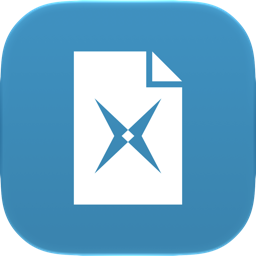

<p align="center">
  
</p>

# E-RNG

App for macOS and Windows for e-invoices: fill in an invoice, get a **ZUGFeRD / Factur-X PDF** (or
an **XRechnung** XML) that was checked before it can be saved.

## Usage

Download from the [latest release](https://github.com/enke-dev/e-rng/releases/latest):

- **macOS** (Apple silicon): `E-RNG_<version>_aarch64.dmg`. Not signed yet: if macOS refuses to open
  it, allow it under System Settings → Privacy & Security → "Open Anyway".
- **Windows 10/11** (64-bit): `E-RNG_<version>_x64-setup.exe`, installs for the current user (no admin
  rights) or, with an admin prompt, for all users. Not signed yet: SmartScreen warns, "Weitere Informationen" → "Trotzdem ausführen".
  Where Smart App Control is on, Windows blocks unsigned apps without a way past it.

Uninstalling keeps the data (invoices must be kept for years); it stays in
`~/Library/Application Support/dev.enke.e-rng` or `%APPDATA%\dev.enke.e-rng`.

## Development

Needs [Bun](https://bun.sh/docs/installation) and [Rust](https://rust-lang.org/tools/install/):

```sh
bun install
bun run generate   # icons and the bundled tools (Mustang, a Java runtime)
bun run dev
```

More in [docs/development.md](docs/development.md), licences in [NOTICE.md](NOTICE.md).
